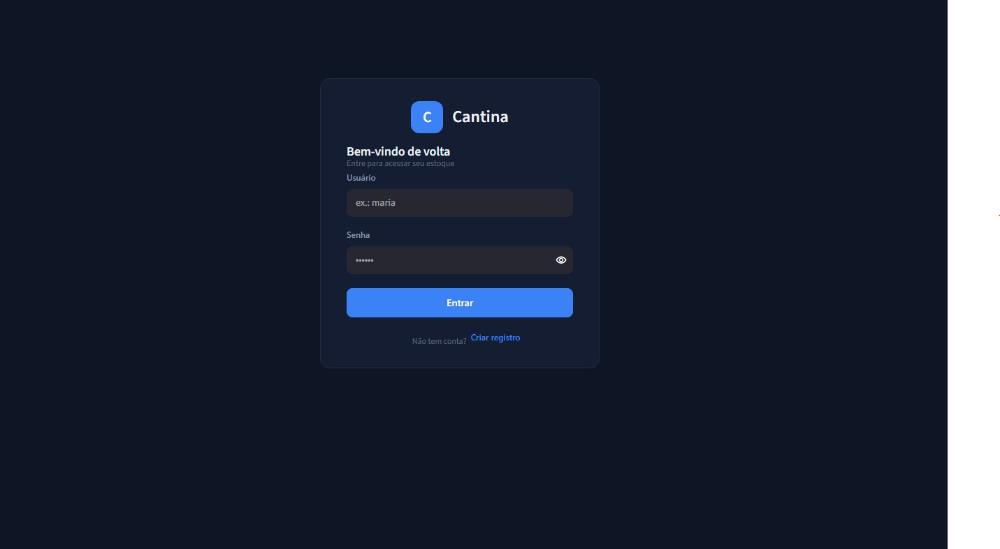
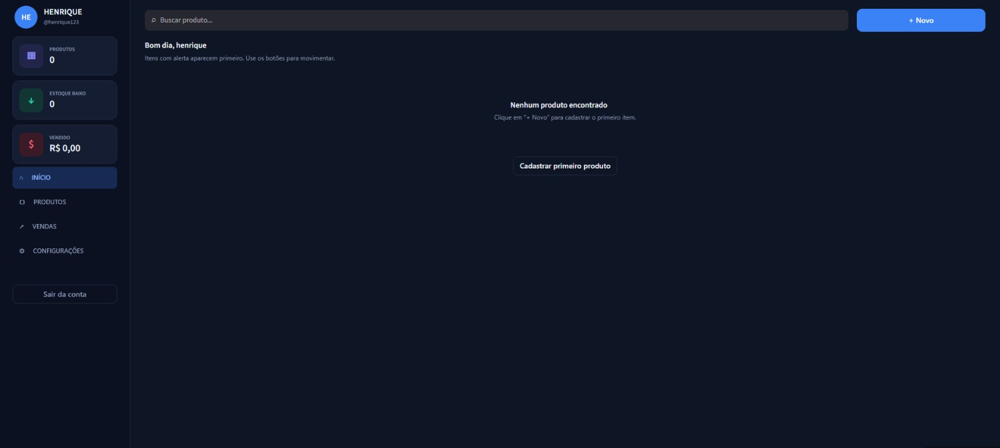
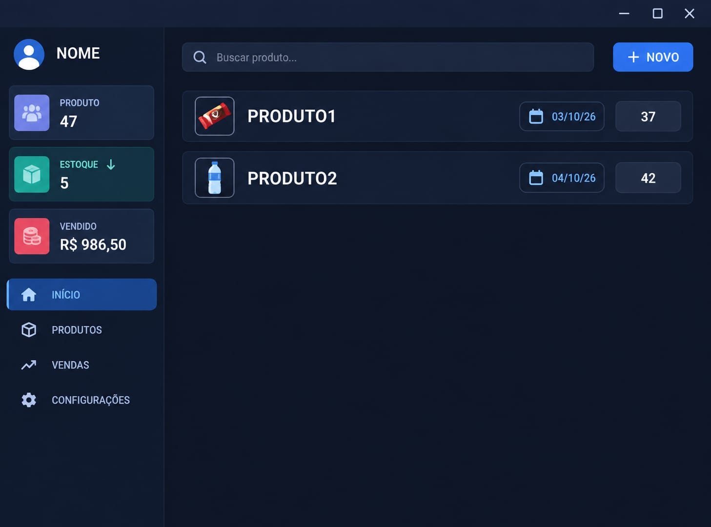

  

<h1 align="center">Kanti</h1>

  <strong>Sua cantina, seu controle.</strong>

  Sistema de gerenciamento de estoque e vendas
  desenvolvido para cantinas escolares.

  

---

## 📑 Sumário

- [Sobre o projeto](#-sobre-o-projeto)
- [Problemas que o sistema busca resolver](#-problemas-que-o-sistema-busca-resolver)
- [Objetivos](#-objetivos)
- [Benefícios](#-benefícios-para-a-gestão-escolar)
- [Funcionalidades](#-funcionalidades)
- [Demonstração do sistema](-demonstração-do-sistema)
- [Usuários e permissões](#-usuários-e-permissões)
- [Tecnologias utilizadas](-tecnologias-utilizadas)
- [Regras de negócio](#-regras-de-negócio)
- [Testes realizados](#-testes-realizados)
- [Banco de dados e segurança](-banco-de-dados-e-segurança)
- [Limitações e melhorias planejadas](-limitações-e-melhorias-planejadas)
- [Estrutura do projeto](-estrutura-do-projeto)
- [Levantamento de requisitos](#-levantamento-de-requisitos)
- [Status do projeto](#-status-do-projeto)
- [Finalidade acadêmica](#-finalidade-acadêmica)
- [Participantes](-participantes)

---

## 🏪 Sobre o projeto

O **Sistema Cantina** é uma aplicação desenvolvida para auxiliar no gerenciamento de estoque e vendas de cantinas escolares.

A solução surgiu da necessidade de melhorar a organização das atividades diárias, especialmente em ambientes onde o controle manual de mercadorias pode ocasionar erros, desperdícios, falta de produtos e dificuldades no acompanhamento das movimentações.

Por meio de uma interface organizada, o sistema permite centralizar informações importantes sobre produtos, estoque e vendas, oferecendo maior praticidade para o responsável pela cantina.

A proposta é tornar o gerenciamento mais simples, proporcionando informações que auxiliem no acompanhamento das operações e na tomada de decisões.

## 🎯 Problemas que o sistema busca resolver

A administração de uma cantina escolar envolve diversas atividades que exigem atenção e organização.

Entre os principais problemas identificados estão:

- Dificuldade para acompanhar a quantidade de produtos disponíveis.
- Falta de controle adequado das entradas e saídas.
- Possibilidade de divergências entre o estoque físico e os registros.
- Dificuldade para identificar produtos com quantidades insuficientes.
- Risco de desperdício relacionado a produtos próximos do vencimento.
- Demora na consulta de informações sobre as movimentações.

O Sistema Cantina busca auxiliar na resolução desses problemas por meio da organização e centralização das informações.

## 🎯 Objetivos

O principal objetivo é desenvolver uma aplicação capaz de facilitar o gerenciamento das operações de uma cantina escolar.

### Objetivos específicos

- Organizar o cadastro dos produtos.
- Controlar as quantidades disponíveis em estoque.
- Registrar entradas e saídas de mercadorias.
- Auxiliar no acompanhamento das vendas.
- Identificar produtos abaixo da quantidade mínima.
- Acompanhar lotes e datas de validade.
- Disponibilizar informações para consultas e relatórios.
- Reduzir erros associados ao controle manual.

## 💡 Benefícios para a gestão escolar

O uso de uma ferramenta informatizada pode contribuir para melhorar a organização das atividades da cantina.

**Mais controle:** acompanhamento das quantidades disponíveis e das movimentações.

**Mais agilidade:** facilidade para registrar e consultar informações.

**Menos desperdício:** identificação de situações relacionadas a estoque insuficiente e produtos próximos do vencimento.

**Melhor planejamento:** informações organizadas que auxiliam na reposição de mercadorias.

**Maior transparência:** possibilidade de acompanhar informações relevantes sobre as operações da cantina.

## ✨ Funcionalidades

O projeto contempla funcionalidades voltadas ao controle operacional e comercial da cantina.

| Funcionalidade | Situação | Descrição |
|---|---|---|
| Cadastro de produtos | Implementada | Registro de informações dos produtos comercializados. |
| Controle de estoque | Implementada | Acompanhamento das quantidades disponíveis. |
| Entrada de produtos | Parcial | Registro das quantidades recebidas. |
| Saída de produtos | Parcial | Registro de perdas e outras retiradas. |
| Controle de vendas | Parcial | Registro das vendas e atualização do estoque. |
| Alerta de estoque baixo | Implementada | Identificação de produtos abaixo do mínimo definido. |
| Controle de validade | Parcial | Acompanhamento de lotes e datas de vencimento. |
| Pesquisa de produtos | Implementada | Localização de produtos cadastrados. |
| Relatórios | Parcial | Consulta de informações sobre estoque, movimentações e vendas. |
| Gerenciamento de usuários | Parcial | Diferenciação de usuários e permissões de acesso. |
| Backup | Planejada | Criação de cópias de segurança do banco de dados. |

> As classificações foram estabelecidas com base no relatório de análise do projeto. Funcionalidades parciais podem possuir limitações de implementação e não devem ser consideradas integralmente concluídas.

## 🖥️ Demonstração do sistema

O Sistema Cantina possui uma interface desenvolvida para organizar as operações e facilitar o acesso às informações.

Abaixo serão apresentadas as principais telas da aplicação.

### Criação de conta

### Painel principal

### Cadastro de produtos

### Protótipo inicial

O planejamento da interface contou com um protótipo em papel, utilizado para organizar a disposição das informações e os principais elementos do painel.

### Protótipo após alterações

## 👥 Usuários e permissões

O sistema foi planejado para atender aos seguintes perfis:

### Responsável pela cantina

Responsável pelas operações diárias de gerenciamento, incluindo:

- Cadastro e consulta de produtos.
- Acompanhamento do estoque.
- Registro de movimentações.
- Acompanhamento das vendas.
- Consulta de alertas.

### Direção da escola

Perfil destinado ao acompanhamento e à supervisão das informações da cantina, incluindo:

- Consulta do estoque.
- Acompanhamento das vendas.
- Visualização de informações gerenciais.
- Verificação de produtos com estoque baixo.

**Limitação identificada:** o relatório de análise apontou falhas no controle de permissões, permitindo que operações de alteração possam ser realizadas mesmo pelo perfil destinado à visualização básica da direção.

A correção desse comportamento está entre as melhorias recomendadas.

## 🛠️ Tecnologias utilizadas

O desenvolvimento do Sistema Cantina utiliza tecnologias voltadas à programação, construção da interface e armazenamento de informações.

| Tecnologia | Finalidade |
|---|---|
| [Python](https://www.python.org/) | Desenvolvimento da aplicação e implementação das regras de negócio. |
| [CSS](https://developer.mozilla.org/pt-BR/docs/Web/CSS) | Estilização da interface. |
| [SQLite](https://www.sqlite.org/) | Armazenamento e gerenciamento dos dados. |
| [Streamlit](https://streamlit.io/) | Desenvolvimento da interface da aplicação. |
| [Git](https://git-scm.com/) | Controle de versão. |
| [GitHub](https://github.com/) | Hospedagem do código e colaboração. |
| Visual Studio Code | Ambiente utilizado no desenvolvimento. |
| XAMPP | Ferramenta identificada no ambiente de desenvolvimento. |

O relatório também identifica o sistema operacional como parte do ambiente utilizado, sem especificar sua distribuição ou versão.

## 📐 Regras de negócio

As regras de negócio definem os comportamentos esperados durante as operações do sistema.

### Regras verificadas

**RN01 — Entrada de produtos:** as entradas válidas incrementam a quantidade disponível no estoque.

**RN02 — Impedimento de quantidades negativas:** o sistema bloqueia saídas quando a quantidade solicitada é superior à quantidade disponível.

**RN03 — Alerta de estoque baixo:** quando o produto atinge ou ultrapassa o limite mínimo estabelecido, o sistema apresenta um aviso visual.

Essas três regras foram confirmadas por inspeção do código ou por testes funcionais, conforme indicado no relatório de análise.

### Outras regras previstas

- As vendas devem gerar a respectiva baixa no estoque.
- Os produtos podem possuir quantidades mínimas configuradas.
- Os lotes podem possuir datas de validade.
- As movimentações devem permitir consultas posteriores.

## 🧪 Testes realizados

Foram realizados testes funcionais para verificar o comportamento da aplicação em situações comuns e situações de erro.

| ID | Teste realizado | Resultado obtido | Status |
|---|---|---|---|
| T01 | Cadastro de produto com campos essenciais vazios. | O sistema bloqueou o envio e solicitou o preenchimento dos campos. | Aprovado |
| T02 | Venda de produto com 10 unidades disponíveis. | O estoque foi reduzido para 9 unidades e a persistência no SQLite foi confirmada. | Aprovado |
| T03 | Tentativa de retirar 50 unidades de um estoque com apenas 20. | O sistema impediu a operação e manteve o estoque em 20 unidades. | Aprovado |
| T04 | Simulação de estoque abaixo do mínimo configurado. | O produto apareceu na lista de alertas críticos. | Aprovado |

Os resultados demonstram que os comportamentos avaliados foram executados conforme o esperado nos cenários testados.

## 🗄️ Banco de dados e segurança

O sistema utiliza o **SQLite** para armazenamento das informações.

Essa tecnologia permite manter os dados em um arquivo de banco de dados local, sem exigir um servidor externo de banco de dados na configuração analisada.

O projeto também contempla mecanismos de validação para proteger a consistência das informações, como:

- Utilização de consultas parametrizadas.
- Validação das quantidades disponíveis.
- Controle das movimentações de estoque.
- Separação dos registros por usuário.

### Situação do backup

A rotina de backup ainda não foi implementada.

Por esse motivo, a versão analisada não possui um mecanismo automático de cópias de segurança e recuperação dos dados.

A implementação desse recurso é considerada uma melhoria importante para aumentar a confiabilidade da aplicação.

## ⚠️ Limitações e melhorias planejadas

A análise técnica identificou pontos que precisam ser aprimorados antes de uma implantação em ambiente real.

### 1. Implementação de backup

<kbd>Alta prioridade</kbd>

Desenvolver um mecanismo em Python para realizar cópias periódicas do banco de dados SQLite, armazenando os arquivos em um diretório seguro ou serviço de armazenamento em nuvem.

### 2. Melhorias no controle de permissões

<kbd>Média prioridade</kbd>

Revisar o gerenciamento de usuários e implementar validações de autorização antes de permitir operações de alteração no banco de dados.

O relatório recomenda a utilização de decoradores em Python para auxiliar nesse controle.

### 3. Aperfeiçoamento das funcionalidades parciais

Continuar o desenvolvimento dos módulos de entradas, saídas, vendas, validade, relatórios e gerenciamento de usuários, buscando maior integração e confiabilidade entre as operações.

## 🗂️ Estrutura do projeto

O projeto está organizado em componentes responsáveis pelas principais operações da aplicação.

- **Produtos:** cadastro, edição e consulta.
- **Estoque:** acompanhamento de quantidades e movimentações.
- **Vendas:** registro das operações comerciais.
- **Alertas:** identificação de produtos abaixo do estoque mínimo.
- **Relatórios:** consulta de informações gerenciais.
- **Usuários:** gerenciamento dos acessos.
- **Banco de dados:** armazenamento das informações.

A estrutura física dos arquivos pode ser consultada diretamente no repositório.

## 📋 Levantamento de requisitos

O levantamento de requisitos foi elaborado por meio de uma entrevista simulada com inteligência artificial, representando as necessidades de uma cantina escolar.

**Informações do levantamento:**

- **Estabelecimento de referência:** Escola Novo Futuro (ENF).
- **Responsável pela cantina no cenário:** Sara Ribeiro de Souza.
- **Responsável pelo levantamento:** Antonio Rodrigues da Silva Neto.
- **Data:** 23/09/2026.

📄 [Consultar formulário de levantamento de requisitos](https://github.com/antoniorodrigues20082006-lab/Trabalho-python-/blob/main/Formulario_Cantina_Estoque.pdf)

> A entrevista foi simulada com inteligência artificial para fins acadêmicos. As informações não representam uma entrevista real realizada com uma funcionária do estabelecimento.

## 🚧 Status do projeto

O Sistema Cantina encontra-se em desenvolvimento e apresenta resultados positivos nos testes funcionais realizados.

| Etapa | Situação |
|---|---|
| Levantamento de requisitos | Concluída |
| Identificação dos usuários | Concluída |
| Definição das funcionalidades | Concluída |
| Protótipo inicial | Concluído |
| Modelagem do banco de dados | Concluída |
| Desenvolvimento do sistema | Concluído |
| Controle de estoque | Implementado |
| Vendas | Implementação parcial |
| Alertas | Implementados |
| Backup | Pendente |
| Testes funcionais registrados | Concluídos |
| Documentação | Concluída |

> A conclusão de uma etapa de desenvolvimento não significa necessariamente que todos os módulos estejam completos. As classificações funcionais detalhadas estão disponíveis na seção de funcionalidades.

## 🎓 Finalidade acadêmica

O Sistema Cantina é um projeto acadêmico desenvolvido no contexto do curso de **Ciência da Computação**, na Estácio.

A atividade tem como finalidade aplicar conhecimentos relacionados a:

- Desenvolvimento de aplicações em Python.
- Banco de dados.
- Levantamento de requisitos.
- Modelagem de sistemas.
- Desenvolvimento de interfaces.
- Regras de negócio.
- Testes de software.

O projeto busca transformar conhecimentos teóricos em uma solução prática voltada às necessidades de gerenciamento de uma cantina escolar.

## 👨‍💻 Participantes

Projeto desenvolvido em colaboração por:

- **Antonio Rodrigues da Silva Neto** — [GitHub](https://github.com/antoniorodrigues20082006-lab)
- **Luiz Henrique** — [GitHub](https://github.com/henriquethe)
- **José Vitor** — [GitHub](https://github.com/Vmotovlogouslq)

---

  

<h3 align="center">🏪 Sistema Cantina</h3>

  Mais organização, controle e eficiência para a gestão da cantina escolar.

  <em>Projeto acadêmico de desenvolvimento de software.</em>

